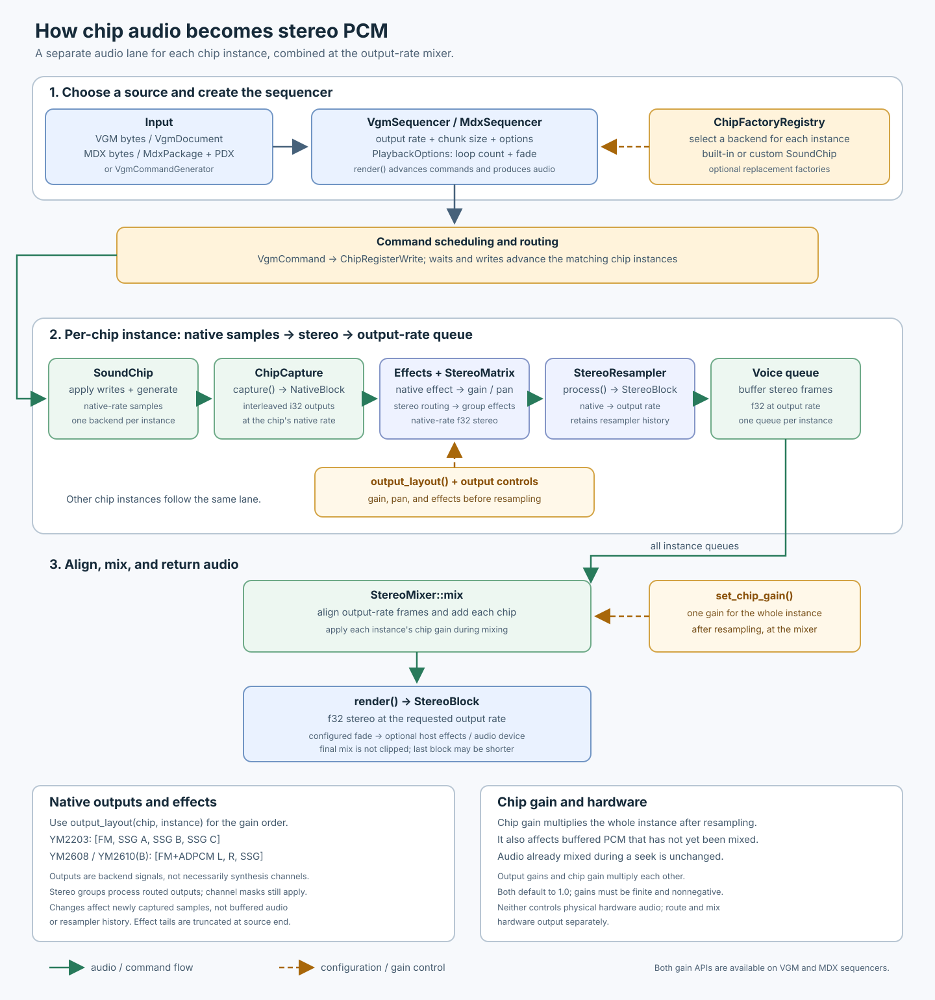
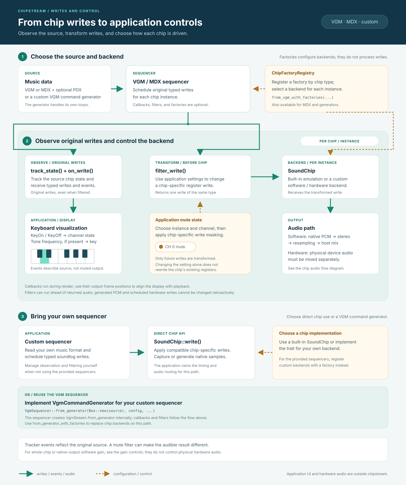

# chipstream

`chipstream` provides retro sound-chip emulation, device-independent VGM and
MDX playback, and audio-processing components for applications and games.

It uses [`soundlog`](https://crates.io/crates/soundlog) for VGM/MDX format
definitions and typed chip writes.

## APIs

| Module | API | Purpose |
| --- | --- | --- |
| `sequencer` | `VgmSequencer`, `MdxSequencer` | Render songs to stereo PCM. |
| `sequencer` | `ChipFactoryRegistry` | Replace chip backends. |
| `chip` | `SoundChip`, chip implementations | Apply writes and generate native samples. |
| `audio` | `ChipCapture`, `NativeBlock` | Capture native samples and chip metadata. |
| `audio` | `StereoMatrix`, `StereoBlock` | Convert native outputs to stereo. |
| `audio` | `StereoResampler`, `StereoMixer` | Resample and mix stereo blocks. |
| `audio` | `StereoEffect` | Process stereo blocks. |

These components can be used without an audio device or an engine. For API
details and limitations, see the rustdoc (`cargo doc -p chipstream --open`).

## How chip audio becomes PCM

The sequencer creates a backend for each chip instance, applies timed register
writes, and renders each chip independently. Each native output is mapped to
stereo and resampled before aligned sources are mixed into the output block.



The factory selects or creates a `SoundChip`; it is not part of the audio
signal path. Resampling can downsample or upsample. The final mix is not clipped.
Backends with addressable sample memory accept ROM and RAM writes separately
through `SoundChip::write_rom` and `SoundChip::write_ram`.

## Cargo features

YMFM chips are always available. Optional features are disabled by default:

| Feature | Chip | Source | Source license |
| --- | --- | --- | --- |
| `ay8910` | AY-3-8910 / 8912 / 8913 | MAME, via libvgm | BSD-3-Clause |
| `c140` | C140 / ASIC219 | MAME | BSD-3-Clause |
| `c352` | Namco C352 | MAME | BSD-3-Clause |
| `es5503` | Ensoniq ES5503 | MAME | BSD-3-Clause |
| `es550x` | Ensoniq ES5505 / ES5506 | MAME | BSD-3-Clause |
| `gb_dmg` | Game Boy DMG | MAME, via Tetorica | BSD-3-Clause |
| `ga20` | Irem GA20 | MAME | BSD-3-Clause |
| `huc6280` | HuC6280 PSG | MAME | BSD-3-Clause |
| `k051649` | K051649 / K052539 (SCC / SCC+) | MAME | BSD-3-Clause |
| `k053260` | Konami K053260 | MAME | BSD-3-Clause |
| `k054539` | Konami K054539 | MAME | BSD-3-Clause |
| `mikey` | Atari Lynx Mikey | libvgm | MIT |
| `multipcm` | Yamaha MultiPCM | MAME | BSD-3-Clause |
| `nes_apu` | NES APU | JSNES, via Tetorica | Apache-2.0 |
| `nes_fds` | FDS expansion audio (includes `nes_apu`) | fixNES, via Tetorica | MIT and Apache-2.0 |
| `upd7759` | NEC uPD7759 | MAME | BSD-3-Clause |
| `okim6258` | OKIM6258 | MAME | BSD-3-Clause |
| `okim6295` | OKIM6295 | MAME | BSD-3-Clause |
| `pokey` | POKEY | MAME | BSD-3-Clause |
| `qsound` | Capcom QSound | qsound-hle | BSD-3-Clause |
| `pwm` | PWM | MAME | BSD-3-Clause |
| `rf5c` | RF5C68 / RF5C164 | MAME | BSD-3-Clause |
| `saa1099` | SAA1099 | MAME | BSD-3-Clause |
| `scsp` | Sega/Yamaha SCSP (YMF292) | MAME | BSD-3-Clause |
| `segapcm` | SegaPCM | MAME | BSD-3-Clause |
| `sn76496` | SN76489 / SN76496 / T6W28 | MAME | BSD-3-Clause |
| `vsu` | Virtual Boy VSU | Rustual Boy | MIT |
| `wonderswan` | WonderSwan | MAME, via Tetorica | BSD-3-Clause |
| `x1010` | Seta X1-010 | MAME | BSD-3-Clause |
| `ymf271` | Yamaha YMF271 | MAME | BSD-3-Clause |
| `ymz280b` | Yamaha YMZ280B | MAME | BSD-3-Clause |

See [third-party notices](THIRD_PARTY_NOTICES.md) for source revisions and
license terms.

YMF271 follows MAME's approximations: PFM is ignored and alternate PCM looping
is rejected. The VGM stereo mix uses CH0/CH1; the native backend exposes all
eight outputs.

QSound uses a DSP-ROM-free HLE with 16 PCM voices, three ADPCM voices, filters,
and echo. Sample ROM data is supplied by VGM data blocks or `write_rom`.
Legacy 4 MHz VGM clocks and their key-on behavior are supported.

ES5505/ES5506 output pairs are mixed to stereo. VGM ROM regions and external
per-voice bank writes are supported. The implementation has been tested with
synthetic data but not verified against a complete ES550x VGM recording.

SCSP provides PCM, FM modulation, and the programmable DSP with shared sample
RAM. External audio inputs and host CPU interrupts are not connected. Playback
has not been verified against a complete SCSP VGM recording. Envelope and DSP
behavior follows MAME's approximations; noise uses a deterministic generator.

Enable the chips your application needs, for example:

```toml
[dependencies]
chipstream = { version = "0.1", features = ["okim6258", "sn76496"] }
```

Except for AY8910, when a VGM header declares one of these chips without its feature,
sequencer construction returns `VgmSequencerError::FeatureDisabled`.
Unsupported chips without implementations remain silent.

MDX playback with a supplied PDX requires `okim6258`, even when the song does
not use PCM notes. Without a PDX, FM-only playback does not require it.

## Sequencers

Render VGM containing a YM2151:

```rust,no_run
use chipstream::sequencer::{Chip, Instance, VgmSequencer};

let bytes = std::fs::read("song.vgm")?;
let mut player = VgmSequencer::from_vgm(bytes, 48_000, 512, Default::default())?;
player.set_chip_gain(Chip::Ym2151, Instance::Primary, 0.5)?;
while let Some(block) = player.render()? {
    // Send block.frames() to the host.
}
# Ok::<(), Box<dyn std::error::Error>>(())
```

Render MDX with a PDX loaded by the host (requires the `okim6258` feature):

```rust,no_run
use chipstream::sequencer::{Chip, Instance, MdxSequencer};

let mdx = std::fs::read("song.mdx")?;
let pdx = std::fs::read("song.pdx")?;
let mut player = MdxSequencer::from_mdx(mdx, Some(pdx), 48_000, 512, Default::default())?;
player.set_chip_gain(Chip::Ym2151, Instance::Primary, 0.8)?;
player.set_chip_gain(Chip::Okim6258, Instance::Primary, 0.5)?;
while let Some(block) = player.render()? {
    // Send block.frames() to the host.
}
# Ok::<(), Box<dyn std::error::Error>>(())
```

### Custom command sources

For a custom command source, implement `soundlog::VgmCommandGenerator` and
pass it to `VgmSequencer::from_generator` with a `GeneratorConfig` containing
the chip header. The sequencer creates a `VgmStream` with
`VgmStream::from_generator` internally. Use `from_generator_with_factories`
to replace backends.

Declare per-instance OKIM6258/OKIM6295 clock ranges, including
intermediate clock-byte values, and SN76489 stereo-mask use in the config:
the generator cannot be scanned ahead of playback.

The generator must emit `EndOfData` and handle its own loops. It is called
synchronously and may be read ahead. Single-pass generators do not support
checkpoints.

```rust
use chipstream::sequencer::{GeneratorConfig, VgmSequencer};
use soundlog::{ParseError, VgmCommandGenerator};
use soundlog::vgm::{VgmHeader, command::{EndOfData, VgmCommand, WaitSamples}};

#[derive(Debug)]
struct Source(u8);
impl VgmCommandGenerator for Source {
    fn next_command(&mut self) -> Result<Option<VgmCommand>, ParseError> {
        let command = match self.0 {
            0 => Some(VgmCommand::WaitSamples(WaitSamples(441))),
            1 => Some(VgmCommand::EndOfData(EndOfData)),
            _ => None,
        };
        self.0 += 1;
        Ok(command)
    }
}
let config = GeneratorConfig {
    header: VgmHeader {
        ym2151_clock: 4_000_000,
        ..Default::default()
    },
    ..Default::default()
};
let mut player = VgmSequencer::from_generator(Box::new(Source(0)), config, 48_000, 512)?;
while let Some(block) = player.render()? {
    // Send block.frames() to the host.
}
# Ok::<(), Box<dyn std::error::Error>>(())
```

### Playback options

Both sequencers require options at construction; their defaults request one
traversal without fading. VGM header loop base and modifier values may change
the effective number of traversals. Use `PlaybackOptions` for loop count and
fade duration:

```rust,no_run
use std::time::Duration;
use chipstream::sequencer::{
    MdxSequencer, MdxSequencerOptions, PlaybackOptions, VgmSequencer, VgmSequencerOptions,
};
use soundlog::mdx::package::MdxPackage;

let playback = PlaybackOptions {
    loop_count: Some(2),
    fadeout: Some(Duration::from_secs(2)),
};
let vgm = VgmSequencer::from_vgm(
    std::fs::read("song.vgm")?,
    48_000,
    512,
    VgmSequencerOptions { playback, ..Default::default() },
)?;
let package = MdxPackage::parse_owned(std::fs::read("song.mdx")?, None)?;
let mdx = MdxSequencer::new(
    package,
    48_000,
    512,
    MdxSequencerOptions { playback, ..Default::default() },
)?;
# Ok::<(), Box<dyn std::error::Error>>(())
```

For VGM, `VgmSequencerOptions` can also override the header's `loop_base` and
`loop_modifier`; `None` preserves the respective header value.
Its `pwm_compatibility` option enables a malformed-rip workaround by default;
set it to `false` to disable the heuristic. The pre-render
`set_pwm_compatibility` method can override this setting and is also available
for generator sources.

`new` accepts parsed documents, while `from_vgm` accepts file bytes. Both have
`_with_factories` variants for custom chip factories.

`None` as the loop count allows unlimited looping. For indefinite MDX playback
also set `max_ticks` to `None`; other resource limits remain active.

PDX lookup is the caller's responsibility. Omitting PDX disables the PCM path
even when the MDX names a PDX.

`measure_vgm_duration_frames` and `measure_mdx_duration_frames` take the same
sequencer options as playback and return `PlaybackDuration::Finite`,
`Unbounded`, or `Unknown`. Scans are bounded: an MDX loop that exceeds the scan
limit, or a duration exceeding `u32::MAX` output frames, is `Unknown`.
Playback itself is not limited by this measurement.

### Gain control

Both sequencers provide `set_chip_gain` for the post-resampling gain of a chip
instance. Use `output_layout` and `set_output_gains` for its native outputs.

For example, YM2203 uses `[Fm, SsgChannel(0), SsgChannel(1),
SsgChannel(2)]`; YM2608 and YM2610(B) use `[FmAdpcmLeft, FmAdpcmRight,
SsgMixed]`. These are backend outputs, not necessarily individual sound
channels.

Gains multiply the existing matrix and header levels, preserving VGM stereo
masks. Output-gain changes affect newly captured samples; buffered audio and
resampler history retain their previous levels. Chip gain also affects unmixed
buffered PCM, but not audio already mixed during a seek. Neither gain controls
physical hardware audio.

### Native-output and stereo-group effects

Both sequencers can process each native output before its matrix routing, and
apply stereo effects to groups of routed outputs before resampling:

```rust,no_run
use chipstream::audio::{Gain, StereoBalance};
use chipstream::sequencer::{Chip, Instance, VgmSequencer};

let bytes = std::fs::read("song.vgm")?;
let mut player = VgmSequencer::from_vgm(bytes, 48_000, 512, Default::default())?;
// YM2608 layout: [FmAdpcmLeft, FmAdpcmRight, SsgMixed]
let ssg = player.add_output_effect(
    Chip::Ym2608,
    Instance::Primary,
    2,
    Gain::new(0.8)?,
)?;
player.set_output_pan(Chip::Ym2608, Instance::Primary, 2, Some(-0.5))?;
let fm = player.create_output_group(Chip::Ym2608, Instance::Primary, &[0, 1])?;
let balance = player.add_group_effect(&fm, StereoBalance::new(0.0)?)?;

// Between render calls, update parameters using the typed handles.
player.effect_mut(&ssg)?.set_gain(0.6)?;
player.effect_mut(&balance)?.set_balance(0.3)?;
while let Some(block) = player.render()? {
    // Send block.frames() to the host.
}
# Ok::<(), Box<dyn std::error::Error>>(())
```

`NativeEffect` processes one output's `f32` samples in native backend units,
at the current native rate. Output effects run before gain, pan, and matrix
routing. A group sums its routed outputs and applies its `StereoEffect` chain.
Ungrouped outputs use the ordinary mix.

An output can belong to at most one group. Removing a group removes its
effects; `move_effect` and `remove_effect` manage individual effects.

Pan is linear from -1 (left) to 1 (right), with both sides at full level at
zero. `None` restores the original routing; explicit pan can route a
left- or right-only output to either side. VGM channel masks apply before
group effects, and backend stereo mutes apply afterward. Group effects can
produce audio on either side.

Effects must be `Clone + 'static`; cloning must independently capture all
parameters and processing state for checkpoints. Restoring a checkpoint
requires the same groups and effect order; it restores their state and pan.
After a checkpoint restore or rendering error, create a new sequencer; playback
and further restoration cannot continue on the failed sequencer.

Stereo effects must preserve frame count and sample rate. Errors and non-finite
output fail rendering. Effect tails are truncated at the source's end.

For custom stereo effects, `StereoBlock::try_transform` uses a reusable
scratch buffer and leaves the block unchanged on error:

```rust
use chipstream::audio::{AudioError, StereoBlock, StereoEffect};

#[derive(Clone, Default)]
struct SwapChannels {
    scratch: Vec<[f32; 2]>,
}

impl StereoEffect for SwapChannels {
    fn process(&mut self, block: &mut StereoBlock) -> Result<(), AudioError> {
        block.try_transform(&mut self.scratch, |frames| {
            for frame in frames {
                frame.swap(0, 1);
            }
            Ok(())
        })
    }
}
```

Mutate effects between `render` calls with exclusive sequencer access. Changes
affect newly captured PCM, not buffered audio or resampler history. Effects do
not control physical hardware.

### Write callbacks and filters



For a keyboard display, use tracked `KeyOn` and `KeyOff` events to maintain
channel state and `KeyOn` tone frequency, when present, to select a key. The
events describe the original writes, so a muted channel can still appear active.

Both sequencers expose `chip_instances` and typed write callbacks. Register
callbacks with `on_write` and state tracking with `track_state` before rendering:

```rust,no_run
use chipstream::sequencer::{Instance, StateEvent, VgmSequencer};
use soundlog::chip::{Ym2151Spec, state::Ym2151State};

let bytes = std::fs::read("song.vgm")?;
let mut player = VgmSequencer::from_vgm(bytes, 48_000, 512, Default::default())?;
player.track_state::<Ym2151State>(Instance::Primary, 3_579_545.0);
player.on_write(|instance, spec: Ym2151Spec, sample, events| {
    if let Some(events) = events {
        for event in events {
            if let StateEvent::KeyOn { channel, tone } = event {
                println!(
                    "{instance:?} sample {sample}: channel {channel} at {:?}",
                    tone.freq_hz
                );
            }
        }
    }
});
while let Some(block) = player.render()? {
    // Send block.frames() to the host.
}
# Ok::<(), Box<dyn std::error::Error>>(())
```

Callbacks receive the instance, typed write, output-frame position, and
optional state changes. They run synchronously during `render`, which may
allocate and is not guaranteed real-time safe.

For SN76489, state tracking uses the VGM header's clock-divider and zero-period
settings. `track_state_with_voice_clocks` also accounts for per-instance
extra-header clock overrides.

Both sequencers also provide `filter_write` to transform a typed register write
before it reaches the chip, including external chip backends:

```rust,no_run
use chipstream::sequencer::{Instance, VgmSequencer};
use soundlog::chip::Ym2151Spec;

let bytes = std::fs::read("song.vgm")?;
let mut player = VgmSequencer::from_vgm(bytes, 48_000, 512, Default::default())?;
player.filter_write(|instance, mut write: Ym2151Spec, _frame| {
    if instance == Instance::Primary && write.register == 0x20 {
        write.value &= 0x3f;
    }
    write
});
while let Some(block) = player.render()? {
    // Send block.frames() to the host.
}
# Ok::<(), Box<dyn std::error::Error>>(())
```

A filter returns one write of the same type. Another filter for that type
replaces it; callbacks and state trackers still see the original writes.
Filters may execute ahead of returned audio, without global ordering across
voices, and cannot change already generated audio or queued hardware events.
For channel mute, keep application mute state and transform the relevant
chip-specific writes. Changing that state alone does not rewrite existing
chip registers; a filter cannot insert or suppress writes.

Filter closure state is not part of checkpoints. The caller must restore it
before restoring or seeking; seeking calls the filter while advancing.

## Chips

Use soundlog's chip-specific `*Spec` values with `SoundChip::write`:

```rust
use chipstream::chip::{SoundChip, YmfmChip};
use soundlog::chip::{Chip, Ym2151Spec};

let mut chip = YmfmChip::new(Chip::Ym2151, 4_000_000)?;
chip.write(Ym2151Spec { register: 0x20, value: 0xc7 })?;
let mut samples = vec![0_i32; chip.channels() * 256];
chip.generate(&mut samples)?;
# Ok::<(), chipstream::chip::ChipError>(())
```

The `chip` module provides `YmfmChip` and, with their respective features,
`Okim6258`, `Okim6258Stream`, `Okim6295`, `Sn76496`, `SegaPcm`, `Pwm`, and
`C140`.

`Okim6258` models direct writes with a single-byte latch. VGM DAC streams and
the `chipstream-ndsif` software fallback use
[`Okim6258Stream`](https://github.com/h1romas4/chipstream/blob/main/crates/chipstream/src/chip/okim6258_stream.rs) for ordered byte delivery.
VGM software playback applies a 20 Hz high-pass filter to the decoded output
to reduce DC-related clicks; direct chip use and MDX playback are unchanged.
The same mono filter is available independently as `audio::DcBlocker`.

See its API documentation for queue, underrun, and stop behavior.
`Okim6258Adpcm` provides the 12-bit predictor and encoder separately.

### External chip backends

Implement `SoundChip` and register a factory with `ChipFactoryRegistry` to
replace a built-in backend. Factories are selected independently by chip type;
unregistered types keep using their built-in implementations. Pass the
registry to `VgmSequencer::from_vgm_with_factories`,
`VgmSequencer::new_with_factories`, or the corresponding
`MdxSequencer` constructor.

The factory receives a `ChipFactoryConfig` with the chip, instance, clock,
output rate, and chip-specific settings. See its rustdoc for all accessors.

`register_optional` can select the built-in backend for individual instances
by returning `Ok(None)`; errors are propagated rather than triggering fallback.
`register_fallback` can add a backend for instances declined by an existing
factory. AY8910 has no default backend, so a declined instance is an error.

With the `ay8910` feature, `register_native_ay8910` opts into native
AY-3-8910/8912/8913 sound generation; `register_native_ay8910_fallback`
preserves an existing factory's priority. AY8914, AY8930, YM-family chips,
raw/discrete output and reserved flags are rejected by this backend. The
three channel outputs use a normalized 1 kΩ load model and are mixed
linearly; external I/O ports are not emulated. An unregistered AY source
remains silent, as before.

To opt into YM2149 approximation, register a factory using
`YmfmChip::new_ym2149(clock, divide_clock)` for `Chip::Ay8910`;
`ay8910_settings().and_then(Ay8910Settings::ym2149_clock_divider)` checks
whether the model and output settings are supported. The three YM2149 outputs
are mixed as AY channels, including VGM per-channel stereo masks.

```rust
use chipstream::chip::{ChipError, YmfmChip};
use chipstream::sequencer::{Ay8910Settings, Chip, ChipFactoryRegistry};

let mut factories = ChipFactoryRegistry::new();
factories.register(Chip::Ay8910, |config| {
    let divide = config.ay8910_settings()
        .and_then(Ay8910Settings::ym2149_clock_divider)
        .ok_or(ChipError::InvalidConfiguration {
            chip: Chip::Ay8910,
            reason: "unsupported AY model or output settings",
        })?;
    Ok(Box::new(YmfmChip::new_ym2149(config.clock(), divide)?))
});
```

YMFM-backed chip types can be replaced individually:

| Chip type | Native outputs per frame |
|---|---:|
| `Ym2413` | 2 |
| `Ym2151` | 2 |
| `Ym2203` | 4 |
| `Ym2608` | 3 |
| `Ym2610b` | 3 |
| `Ym2612` | 2 |
| `Ym3526` | 1 |
| `Y8950` | 1 |
| `Ym3812` | 1 |
| `Ymf262` | 4 |
| `Ymf278b` | 6 |

The backend must report the configured chip type and clock, and match the
native output count above. Its `generate()` method supplies samples to the
sequencer. Routing writes to physical hardware does not route its audio into
host PCM.

Implement `save_state()` and `restore_state()` for checkpoint seeking.
Scheduled backends must also opt into `supports_checkpoint`; DAC-interrupting
backends cannot currently use checkpoints. See `SoundChip` and `ScheduledChip`
in rustdoc for details.

The VGM sequencer applies backend output balancing to built-in and custom
backends alike: SN76489 is multiplied by 0.5, YM2203 SSG by 0.25, and
YM2608/YM2610(B) SSG by 0.375. When the VGM declares a YM2612, other chips
are additionally multiplied by 2/3 while the YM2612 level remains unchanged.
VGM header volume settings, `set_chip_gain`, and `set_output_gains` multiply
these levels.

### NDSIF scheduled output

Use `chipstream-ndsif` for hardware-backed chip adapters and routing. Hardware
audio is emitted by the physical device and must be mixed separately from
host PCM. See the `chipstream-ndsif` README for supported chips and examples.

## Audio processing

Mix YM2203's four native outputs into stereo, then resample and add them to a
stereo bus. In this example, FM is centered and SSG channels A and B are
panned left and right:

```rust
use chipstream::audio::{ChipCapture, StereoBlock, StereoMatrix, StereoMixer, StereoResampler};
use chipstream::chip::{SampleRate, SoundChip, YmfmChip};
use soundlog::chip::{Chip, Ym2203Spec};

let chip = YmfmChip::new(Chip::Ym2203, 4_000_000)?;
let native_rate = chip.sample_rate();
let mut capture = ChipCapture::new(chip);
for (register, value) in [(0, 0x24), (1, 0x01), (2, 0x90), (3, 0x01),
                          (7, 0x3c), (8, 0x0f), (9, 0x0f)] {
    capture.chip_mut().write(Ym2203Spec { register, value })?;
}
let scale = 1.0 / 32768.0;
let matrix = StereoMatrix::new(vec![
    [scale, scale], // FM
    [scale, 0.0],   // SSG A
    [0.0, scale],   // SSG B
    [scale, scale], // SSG C
])?;
let mut src = StereoResampler::new(48_000, native_rate, native_rate, 4096)?;

let mut samples = [0; 4 * 4096];
let native = capture.capture(&mut samples)?;
# assert!(native.samples().chunks_exact(4).any(|frame| frame[1] != 0 && frame[2] != 0));
let stereo = matrix.convert(&native)?;
# assert!(stereo.frames().iter().any(|frame| frame[0] != frame[1]));
let converted = src.process(&stereo)?;
let tail = src.finish()?; // Drain once at the end of the stream.
# assert!(converted.frames().iter().chain(tail.frames())
#     .any(|frame| frame[0] != 0.0 && frame[1] != 0.0));
for block in [converted, tail] {
    let mut bus = StereoBlock::silence(SampleRate::from_hz(48_000), block.frames().len())?;
    StereoMixer::mix(&mut bus, &block, 1.0)?;
    // Send bus.frames() to the host.
}
# Ok::<(), Box<dyn std::error::Error>>(())
```

The coefficients control routing and scaling; mixing does not clip. Mix
additional stereo sources into the bus after aligning their rates and frame
counts. `Gain` and `StereoBalance` provide additional processing.

## License

BSD-3-Clause License

## Third-party notices

See [THIRD_PARTY_NOTICES.md](https://github.com/h1romas4/chipstream/blob/main/crates/chipstream/THIRD_PARTY_NOTICES.md) for implementation
attributions and licenses. Distributors should also review the licenses of
transitive dependencies.
